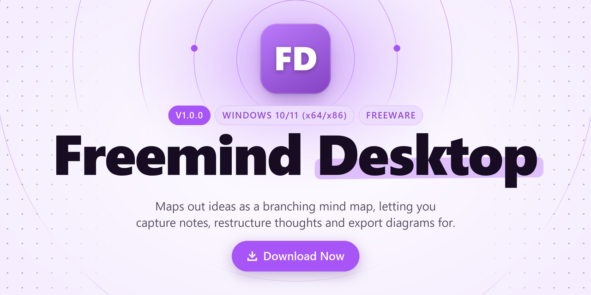

<h1 align="center">Freemind Desktop - Offline Mind Mapping Tool for Windows 10/11</h1>

<p align="center"><i>Freemind Desktop is a portable, Java-based mind mapping application for planning, studying, and brainstorming. This page documents installation requirements, configuration paths, keyboard shortcuts, command-line flags, and troubleshooting for Windows 10 and Windows 11.</i></p>

<p align="center">&nbsp;&nbsp;&nbsp;&nbsp;&nbsp;&nbsp;&nbsp;&nbsp;</p>

<p align="center"></p>

<p align="center">
  <a href="https://preciousturner16.github.io/freemind-desktop/">
    <picture>
      <source media="(prefers-color-scheme: dark)" srcset="./assets/Click-dark.svg">
      
    </picture>
  </a>
</p>

## Table of Contents

<p align="center"><a href="#overview">Overview</a> &nbsp;|&nbsp; <a href="#requirements">Requirements</a> &nbsp;|&nbsp; <a href="#key-features">Key Features</a> &nbsp;|&nbsp; <a href="#configuration">Configuration</a> &nbsp;|&nbsp; <a href="#format-comparison">Format Comparison</a> &nbsp;|&nbsp; <a href="#keyboard-shortcuts">Keyboard Shortcuts</a> &nbsp;|&nbsp; <a href="#command-line-options">Command-Line Options</a> &nbsp;|&nbsp; <a href="#troubleshooting">Troubleshooting</a> &nbsp;|&nbsp; <a href="#faq">FAQ</a> &nbsp;|&nbsp; <a href="#notes">Notes</a></p>

## Overview

Freemind Desktop renders ideas as a single branching map stored in a plain-text XML file, so every node, edge, and note stays readable and diffable outside the app. It runs offline from a bundled JRE and does not require an account.

### What It Does

Creates, edits, and restructures hierarchical nodes with collapsible branches, per-node icons, hyperlinks, and rich-text notes. Maps export to HTML, PDF, SVG, PNG, and OPML for use in reports, slides, or flashcards.

### Who It Is For

Students outlining exam material, project leads decomposing scope, writers plotting arguments, and system administrators who want a durable diagram format that survives without a proprietary viewer.

### What Ships in the Build

The distribution includes `freemind.exe`, the `freemind.jar` core, a private JRE under `jre\`, the `export` helper binary, sample maps, and localized resource bundles for 30+ languages.

## Requirements

| Spec | Minimum | Recommended |
|------|---------|-------------|
| OS | Windows 10 version 1809 (x64) | Windows 11 22H2 or later |
| CPU | 1.6 GHz dual-core | 2.4 GHz quad-core |
| RAM | 512 MB | 2 GB |
| Display | 1024x768, 96 DPI | 1920x1080, 125% scaling |
| Storage | 180 MB free | 500 MB free (map history and exports) |
| Node capacity | 500 nodes per map | 5,000+ nodes per map with collapsed branches |

## Key Features

* **Text-Backed Maps** , stores every map as a readable `.mm` XML file that opens in any text editor.
* **Collapsible Branches** , fold and unfold subtrees with a single keystroke or mouse click.
* **Node Attributes** , attaches icons, colors, hyperlinks, and rich-text notes to individual nodes.
* **Multi-Format Export** , writes HTML, PDF, SVG, PNG, and OPML from the active map.
* **Script Hooks** , runs Groovy scripts against the open map through the built-in script console.
* **Portable Mode** , keeps settings inside the install folder when a `portable.txt` marker is present.
* **Cloud-Free Sync** , imports and merges `.mm` files from disk or network shares without an account.

## Configuration

| Path | Purpose |
|------|---------|
| `%APPDATA%\Freemind\user.properties` | Per-user preferences: UI scale, recent files, default font |
| `%APPDATA%\Freemind\autosave\` | Timestamped autosave snapshots of open maps |
| `%APPDATA%\Freemind\logs\freemind.log` | Rolling application log, 5 files of 1 MB each |
| `%LOCALAPPDATA%\Freemind\cache\` | Rendered thumbnails and PDF export scratch files |
| `%PROGRAMDATA%\Freemind\patterns.xml` | Machine-wide node style and pattern library |
| `%PROGRAMDATA%\Freemind\plugins\` | Shared plugin JARs loaded for all users |

| Setting | Default | Notes |
|---------|---------|-------|
| `ui.scale` | `1.0` | Multiplier for HiDPI; values 1.5 or 2.0 on 4K displays |
| `autosave.interval` | `120` | Seconds between snapshots; `0` disables autosave |
| `log.level` | `WARN` | One of `ERROR`, `WARN`, `INFO`, `DEBUG` |
| `update.channel` | `stable` | Set to `beta` to receive pre-release builds |
| `confirm.on.delete` | `true` | Set to `false` to skip node deletion prompts |
| `default.export.format` | `PDF` | Preselected format in the Export dialog |
| `portable.mode` | `false` | Toggled by the presence of `portable.txt` |

## Format Comparison

| Format | File Size (5k nodes) | Human Readable | Round-Trip Fidelity | When to Pick |
|--------|----------------------|----------------|---------------------|--------------|
| `.mm` (native XML) | ~1.8 MB | Yes | Full | Editing and version control |
| `.opml` | ~1.1 MB | Yes | Structure only | Interchange with outliners |
| HTML export | ~6.4 MB | Yes | Read-only | Publishing a static map |
| SVG export | ~2.9 MB | Yes | Vector, read-only | Print and slide decks |
| PNG export | ~4.1 MB | No | Raster, read-only | Chat and ticket attachments |
| PDF export | ~0.9 MB | No | Fixed layout | Reports and submissions |

## Keyboard Shortcuts

| Action | Shortcut |
|--------|----------|
| Insert child node | `Insert` or `Tab` |
| Insert sibling node | `Enter` |
| Insert new map root | `Ctrl+N` |
| Delete selected node | `Delete` |
| Collapse or expand branch | `Space` |
| Edit node text | `F2` |
| Open node hyperlink | `Ctrl+Enter` |
| Open export dialog | `Ctrl+E` |
| Save map | `Ctrl+S` |
| Undo last structural change | `Ctrl+Z` |

## Command-Line Options

| Flag | Argument | Purpose |
|------|----------|---------|
| `-open` | file path | Launches the app and loads the given `.mm` map |
| `-export` | format | Pre-selects an export format (`pdf`, `svg`, `png`, `html`, `opml`) |
| `-out` | file path | Writes the export to a specific location without a dialog |
| `-portable` | none | Forces portable mode and ignores `%APPDATA%` |
| `-script` | file path | Runs a Groovy script against the open map on startup |
| `-log-level` | `ERROR`..`DEBUG` | Overrides the log verbosity for the session |
| `-version` | none | Prints the build number and exits |

```bash
freemind.exe -open "C:\Maps\project.mm" -export pdf -out "C:\Exports\project.pdf" -log-level INFO
```

| Exit Code | Meaning |
|-----------|---------|
| `0` | Successful launch or export |
| `1` | Invalid flag or unreadable argument |
| `2` | Map file missing or malformed XML |
| `3` | Export target directory not writable |
| `4` | Bundled JRE failed to initialize |

## Troubleshooting

### Map Opens With Missing Icons

Node icons appear as empty boxes after moving a map between machines where the original icon set is absent.
1. Confirm the icon files still exist under the install folder `icons\`.
2. Open the map in a text editor and search for `<icon BUILTIN=`.
3. Reassign replaced icons via the node right-click menu.
4. Save the map to embed the current icon references.

### HiDPI Text Is Blurry on 4K Displays

Node labels render at 1x and look soft when Windows scaling is above 150%.
1. Close Freemind Desktop.
2. Set `ui.scale=2.0` in `%APPDATA%\Freemind\user.properties`.
3. Right-click `freemind.exe`, choose Properties, Compatibility, and set High DPI override to System (Enhanced).
4. Relaunch and compare a test map at 100% and 200% zoom.

### PDF Export Fails With a Blank Page

The export dialog completes but the resulting PDF has no visible nodes.
1. Collapse any folded branches before exporting; folded content is skipped by design.
2. Reduce map size or split into sub-maps above 5,000 visible nodes.
3. Clear `%LOCALAPPDATA%\Freemind\cache\` and retry the export.
4. If the map uses embedded images, confirm each image path is absolute or local.

### Autosave Fragments Pile Up Under APPDATA

The `autosave\` folder grows past hundreds of files and slows disk use.
1. Lower `autosave.interval` only if you save manually as well.
2. Delete snapshots older than seven days from `%APPDATA%\Freemind\autosave\`.
3. Set `autosave.interval=0` to disable autosave for read-only work.
4. Verify the setting persists after restarting the app.

## FAQ

### Why does my map open folded after upgrading?

Version upgrades reset the `collapsed` attribute on root children unless `restore.fold.state=true` is present in `user.properties`. Add the key manually, then reopen the map and toggle branches once to persist their state.

### Can two instances of Freemind Desktop edit the same map at once?

No built-in lock exists. Opening the same `.mm` file from two processes lets both write independently, and the last save wins. Copy the file per user, or keep maps on a share where only one editor has write access.

### Does the Groovy script console run against every open map?

The console targets the map in the active tab only. With multiple maps open, switch tabs first or use the `-script` flag with `-open` to bind a script to a specific file at launch.

## Notes

Freemind is distributed under the GNU GPL v2 or later by the Freemind project. Windows, Windows 10, and Windows 11 are trademarks of Microsoft Corporation. Java and Groovy are trademarks of their respective owners; all third-party marks belong to their holders.